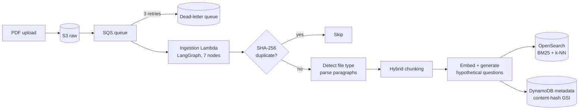
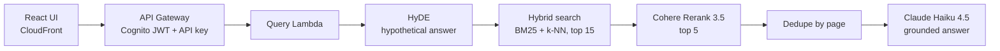

# Legal RAG Pipeline on AWS

A serverless retrieval-augmented generation system for legal documents (court decisions). It ingests PDFs through an event-driven pipeline, indexes them for **hybrid search**, and answers questions with grounded, cited responses. Quality is measured with a **four-metric LLM-as-judge evaluation** in LangSmith.

**Eval (50-question set, LangSmith):** answer correctness **0.88** | answer relevance **0.84**

The architecture is documented in **[23 architecture decision records](docs/DECISIONS_ADR.md)**, and the full stack is defined in **[CloudFormation](docs/rag-stack.yaml)**.

---

## Architecture

### Ingestion (event-driven, LangGraph)

### Query (LangChain LCEL)

---

## Key design decisions

| Area | Decision | Why |
|---|---|---|
| Ingestion trigger | S3 -> **SQS** -> Lambda, with a DLQ | Durable events, automatic retry, no silent data loss (ADR-001) |
| Deduplication | **SHA-256 of file bytes** on a DynamoDB **GSI** | Catches renamed re-uploads; GSI enables lookup by hash without knowing the document ID (ADR-002, 003, 011) |
| Orchestration | **LangGraph** for ingestion, **LCEL** for query | Ingestion has branches (duplicate, file type, errors); query is a fixed linear chain (ADR-007, 012) |
| Parsing | **pypdf** | pdfplumber had a dependency conflict, and PyMuPDF exceeded Lambda size limits (ADR-008) |
| Chunking | Structural split -> semantic merge (cosine >= 0.75, same section) -> recursive split at 448 tokens | Pure semantic chunking merges legal holdings with the facts they apply to (ADR-009) |
| Retrieval boost | **HyQ** at ingestion: 3 hypothetical questions per chunk, BM25-boosted 2x | Question-to-question matching at zero query-time cost (ADR-010) |
| Query embedding | **HyDE**: embed a hypothetical answer, not the question | Answer-shaped vectors sit closer to stored chunks (ADR-013) |
| Search | Hybrid **BM25 + k-NN, 0.5 / 0.5**, min-max normalized | Legal text needs exact terms (statute codes) *and* semantics; 0.7/0.3 tested and reverted (ADR-014) |
| Reranking | **Cohere Rerank 3.5** cross-encoder, 15 -> 5 | top_n = 7 was tested and lowered context precision (ADR-015) |
| Context | 3,000-token budget, one chunk per page | Raised from 2,000 after a measured correctness gain (ADR-016, 017) |
| Auth | **Cognito JWT + API key** with a usage plan | Identity and throttling are separate concerns (ADR-022) |
| Observability | **CloudWatch + X-Ray + LangSmith** | Infrastructure health, service latency, and AI-step quality each need a different tool (ADR-006) |

---

## Evaluation

Four custom LLM-as-judge evaluators (Claude Haiku 4.5) on 50 curated question / expected-answer pairs, recorded in LangSmith:

| Metric | Layer it diagnoses |
|---|---|
| `answer_correctness` | End to end |
| `answer_relevance` | Generation |
| `faithfulness` | Retrieval -> generation boundary (hallucination) |
| `context_precision` | Retrieval |

**What moved the numbers:**
- Model upgrade, **Titan Embed v1 + Nova Micro -> Cohere Embed v4 + Claude Haiku 4.5**: the largest single gain in the project. Retrieval and answer quality compound through HyQ and HyDE (ADR-018, 019).
- Context budget 2,000 -> 3,000 tokens: improved correctness.
- Rerank top_n 7 -> 5: context precision recovered (0.34 -> 0.44).

**Known weak point:** context precision is the lowest metric. It's partly a chunking problem, and the next experiments target it.

---

## Infrastructure and operations

- **Infrastructure as code:** [`docs/rag-stack.yaml`](docs/rag-stack.yaml) (CloudFormation), with a [deployment guide](docs/IaC_Deployment_Guide.md)
- **Lambda:** arm64 (Graviton), 512 MB. 256 MB ran out of memory during LangGraph initialization (ADR-004)
- **Cost control:** the OpenSearch domain is shut down between demos and restored from snapshot ([runbook](docs/OpenSearch_Reactivation_Runbook.md)). DynamoDB is on-demand
- **Warm-path latency:** cached Bedrock and OpenSearch clients (`lru_cache`) cut about 0.8 s of connection setup per warm invocation (ADR-021)
- **Input validation** at the Lambda boundary rejects bad requests before any Bedrock or OpenSearch call (ADR-020)

## Known limitations (POC scope)

- Shared IAM role across both Lambdas, so not least-privilege (ADR-004)
- Cognito implicit grant puts the JWT in the browser URL. Production fix: authorization code flow with PKCE (ADR-022)
- The API key ships in the frontend bundle. It's only usable together with a valid Cognito JWT (ADR-022)
- HyQ matching is lexical (BM25). Planned upgrade: embed the questions as a second k-NN field (ADR-010)
- No OCR, so scanned PDFs aren't supported. Planned: a Textract pre-processing step (ADR-008)
- LLM-as-judge uses the same model family it evaluates (ADR-023)

## Tech stack

Python 3.11 | LangGraph | LangChain (LCEL) | Amazon Bedrock (Claude Haiku 4.5, Cohere Embed v4, Cohere Rerank 3.5) | OpenSearch | Lambda | SQS | S3 | DynamoDB | API Gateway | Cognito | CloudFront | CloudFormation | CloudWatch | X-Ray | LangSmith | React